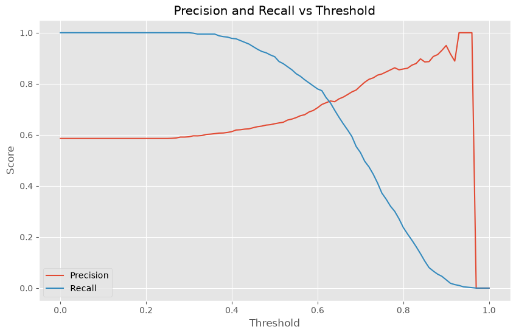
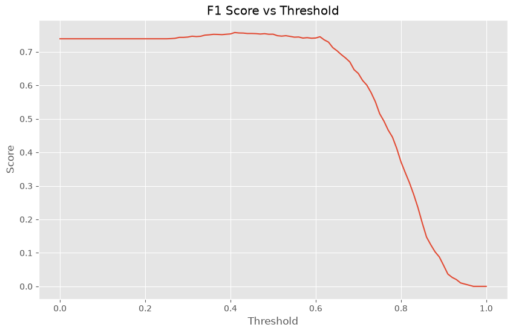

<div align="center">

<!-- HERO BANNER -->


<!-- TYPING INTRO -->


</div>

<!-- TECH ICONS -->
<p align="center">


</p>

---

<!-- ABOUT -->
### About

Fourth assignment of the **Machine Learning Zoomcamp 2026** organized by **DataTalks Club**. You can enroll in the course here: [courses.datatalks.club/ml-zoomcamp-2026](https://courses.datatalks.club/ml-zoomcamp-2026/).

This project covers **model evaluation for classification** on the same lead-scoring problem. We measure feature importance with ROC AUC, train a logistic regression on one-hot encoded features, then go beyond accuracy with **precision / recall curves**, the **F1 score**, and threshold selection. Finally we use **5-fold cross-validation** to quantify score variability and tune the regularization parameter `C`.

The **course_lead_scoring_2026.csv** dataset contains 5,000 lead records (source, industry, employment status, location, income, courses viewed, interactions, lead score) and the target `converted` telling whether the lead signed up to the platform.

<div align="center">


</div>

---

<!-- STATS BAR -->
<table>
<tr>
<td align="center" width="120">

**5K**
Rows

</td>
<td align="center" width="120">

**8**
Features

</td>
<td align="center" width="120">

**6**
Questions

</td>
<td align="center" width="120">

**0.732**
Val AUC

</td>
<td align="center" width="120">

**0.749**
Best CV AUC

</td>
</tr>
</table>

---

<!-- QUESTIONS -->
### Homework Questions

<table>
<tr>
<td width="50%">

#### Q1 - Q2 : ROC AUC & Baseline Model

- **Q1** : Highest AUC (`lead_score` : 0.79)
- **Q2** : Validation AUC (`0.732`)

</td>
<td width="50%">

#### Q3 - Q4 : Precision, Recall & F1

- **Q3** : Curves intersect (`0.63`)
- **Q4** : Maximal F1 (`0.41`)

</td>
</tr>
</table>

<table>
<tr>
<td width="50%">

#### Q5 - Q6 : Cross-Validation & Tuning

- **Q5** : Std of the 5 fold scores (`0.007`)
- **Q6** : Best `C` (`C = 0.001` : mean AUC 0.749)

</td>
<td width="50%">

#### Key Takeaways

- `lead_score` alone already ranks leads well (AUC 0.79)
- Precision & recall cross at `0.63` — the balanced operating point
- F1 peaks at `0.41`, where the harmonic mean is maximized
- Folds are very stable (std 0.007), so the mean AUC is trustworthy
- Stronger regularization (`C = 0.001`) beats the weakly regularized model

</td>
</tr>
</table>

---

<!-- KEY CONCEPTS -->
### Key Concepts

<table>
<tr>
<td width="33%">

#### ROC AUC
- Feature importance via single-variable AUC
- Negate the variable if AUC < 0.5
- Rank-based metric, threshold-free

</td>
<td width="34%">

#### Threshold Metrics
- Precision / recall curves (step 0.01)
- F1 = 2 · P · R / (P + R)
- Selecting the operating point

</td>
<td width="33%">

#### Cross-Validation
- `KFold(n_splits=5, shuffle=True, random_state=1)`
- Mean ± std of fold AUCs
- Tuning the regularization `C`

</td>
</tr>
</table>

---

<!-- STRUCTURE -->
### Project Structure

```
HW4/
├── course_lead_scoring_2026.csv       # Dataset (5K leads)
├── data/                              # Copy of the pinned 2026 release
├── notebook.ipynb                     # Notebook with all 6 solutions
├── pyproject.toml                     # Project configuration
├── shun_hashimoto.jpg                 # Banner image (used in README)
├── precision_recall_threshold.png     # Precision / recall vs threshold
├── f1_threshold.png                   # F1 vs threshold
└── README.md
```

---

<!-- SETUP -->
### Installation

```bash
# Clone the repo
git clone <repo-url>
cd HW4

# Install dependencies (with uv)
uv sync

# Launch the notebook
uv run jupyter notebook notebook.ipynb
```

---

<!-- DATASET PREVIEW -->
### Dataset Preview

| lead_source | industry | employment_status | location | annual_income | number_of_courses_viewed | interaction_count | lead_score | converted |
|:---:|:---:|:---:|:---:|:---:|:---:|:---:|:---:|:---:|
| organic_search | technology | employed | europe | 88160 | 3 | 4 | 0.64 | 1 |
| social_media | technology | employed | south_america | 72688 | 3 | 7 | 0.72 | 1 |
| referral | retail | employed | europe | 44697 | 3 | 4 | 0.58 | 1 |
| paid_ads | manufacturing | student | NA | 0.0 | 3 | 6 | 0.57 | 0 |
| referral | manufacturing | student | north_america | 24062 | 4 | 5 | 0.62 | 1 |

---

<!-- RESULTS -->
### Results Summary

| Question | Answer | Detail |
|:---:|:---:|:---|
| Q1 | `lead_score` | Highest ROC AUC among the numerical features (0.788) |
| Q2 | `0.732` | AUC of logistic regression on the validation set |
| Q3 | `0.63` | Smallest \|precision − recall\| (0.733 vs 0.725) |
| Q4 | `0.41` | Threshold maximizing F1 (F1 = 0.758) |
| Q5 | `0.007` | Std of the 5 fold AUCs (mean 0.732) |
| Q6 | `0.001` | Best `C`, mean AUC `0.749` (std 0.010) |

---

<!-- VISUALS -->
### Inside the Notebook — Threshold Curves

#### 1 — Precision & recall vs threshold
Both curves are computed on every threshold from 0.0 to 1.0 (step 0.01). They **cross at 0.63**, the smallest absolute gap between precision (0.733) and recall (0.725).

<div align="center">



</div>

#### 2 — F1 score vs threshold
The F1 curve peaks at **threshold 0.41** with **F1 = 0.758** — lower thresholds flood the positives (recall up, precision down), higher thresholds starve them.

<div align="center">



</div>

#### 3 — Cross-validation at a glance
5 folds over `df_full_train` with `C = 1.0`:

| Fold | AUC |
|:---:|:---:|
| 1 | 0.7306 |
| 2 | 0.7296 |
| 3 | 0.7363 |
| 4 | 0.7412 |
| 5 | 0.7209 |
| **Mean ± std** | **0.732 ± 0.007** |

*The homework model scored 0.732 on the validation split, right in line with the CV mean — a good sign that the split was not lucky. Tuning `C` then lifted the mean AUC to 0.749 with `C = 0.001`.*

---

<!-- FOOTER -->
<div align="center">


**Machine Learning Zoomcamp 2026 -- DataTalks Club**

</div>
